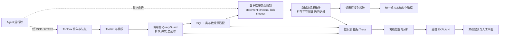

# Toolbox MCP 安全查询与数据库稳定性治理产品技术方案

> 方案版本：v1.3（阶段一、二已在 `feat/query-guard` 分支实现，MySQL 优先；变更见第 15 至 17 节）  
> 适用对象：产品、Toolbox 服务端、数据库、平台安全、SRE 与 Agent 应用团队  
> 目标：在保留自然语言数据查询能力的同时，实现敏感数据不泄露、慢查询可止损、性能问题可分析、数据库访问不可绕过。

## 1. 方案摘要

建设统一的 **Secure Query Gateway（安全查询网关）**。Agent 只能通过 Toolbox MCP 访问数据；Toolbox 在统一执行链路中提供按列脱敏、并发控制、分层超时、结果限量、结构化慢日志和受控 EXPLAIN。数据库凭证仅由 Toolbox 持有，Agent 到数据库的网络路径默认关闭，数据库只接受 Toolbox 的专用身份。

设计遵循四条原则：

1. **默认安全**：未配置或未识别的结果不得绕过脱敏与限制。
2. **失败关闭**：超限、超时、无法脱敏时明确失败，不返回部分敏感数据，不自动换路。
3. **统一治理、分层落地**：调用级能力放在 `Invoke` 外层的共享链路，语句级和行级能力下沉到数据源读取循环；数据源不具备相应能力时拒绝启用，避免遗漏或虚假防护。
4. **防绕过靠基础设施**：提示词只用于规范行为，真正的边界是凭证、网络、数据库身份与沙箱权限。

建议分四期交付：先止损和可观测，再脱敏和受控分析，随后完成网络与身份隔离，最后建设离线索引优化闭环。

## 2. 背景与问题定义

当前场景存在五类相互关联的问题：

- 客户名称、手机号等敏感列可能随查询结果进入模型上下文。
- 模型可能生成大范围扫描、复杂 Join 或无界结果查询，耗尽数据库 CPU、IO、连接和锁资源。
- MCP 调用超时后，如果错误不可操作，Agent 可能重试或尝试其他连接方式。
- 慢查询缺少统一指纹、调用方、耗时和结果状态，难以定位应优化 SQL、统计信息还是索引。
- 如果 Agent 环境具备数据库凭证、驱动和网络权限，单靠 Prompt 无法阻止其绕过 Toolbox。

这些问题不能只通过“限制返回行数”或“增加一个超时参数”解决。少量结果也可能来自全表扫描；客户端超时也不一定终止数据库执行；网络可达时禁止驱动并不能阻止 Shell 或代码执行建立连接。

## 3. 仓库现状与设计约束

以下为本方案编写时观察到的代码现状，不代表功能已经实现：

| 现状 | 证据 | 方案约束 |
|---|---|---|
| 工具通过统一 `Tool` 接口调用，HTTP 和 5 个 MCP 版本共 6 条路径最终进入 `Invoke` | `internal/tools/tools.go:125-143` | 可在工具外层做统一装饰，避免分别修改每个 API 入口；但 `Invoke` 之前的逻辑不受装饰器保护 |
| 工具初始化集中在 `initializeTools`，`toolbox invoke` CLI 同样经过 `InitializeConfigs` | `internal/server/server.go:411-434`、`cmd/internal/invoke/command.go:68` | 在此包装可同时覆盖服务端和 CLI，包装后须转发可选接口 |
| `RunSQL` 在返回前把全部行读入内存，且共有 27 个 Source 文件各自实现 | `internal/sources/postgres/postgres.go:116-143` | `Invoke` 外层无法在读取中途限量；行和字节预算必须进入读取循环 |
| 模板参数在 `Invoke` 内解析，且为 `text/template` 文本替换 | `internal/tools/postgres/postgressql/postgressql.go:98`、`internal/util/parameters/parameters.go:279-301` | 装饰器看不到最终 SQL，无法生成指纹；模板参数可改变语句和返回列 |
| `ConfigBase` 是工具共享配置入口，全部 322 个工具类型文件均嵌入 | `internal/tools/tools.go:206-218` | 新字段会被所有工具接受，必须在启动时校验该工具是否适用；数据库执行预算需要结合 Source 能力 |
| PostgreSQL SQL 工具直接返回数据库结果 | `internal/tools/postgres/postgressql/postgressql.go:100-112` | 脱敏必须覆盖实际行类型和全部结果出口 |
| `StructuredToolResult` 同时包含 Content 与 StructuredContent | `internal/tools/tools.go:160-166` | 两个出口必须一致治理，避免原始值从结构化内容泄露 |
| MySQL `queryTimeout` 设置驱动 `ReadTimeout`；go-sql-driver v1.10.0 取消 Context 时只关闭连接，不发送 `KILL QUERY` | `internal/sources/mysql/mysql.go:204-210`、驱动 `connection.go` | 网络超时和 Context 取消都不等于服务端停止执行，MySQL 必须依赖服务端限制 |
| pgx v5.10.0 默认只设置连接截止时间，随后在异步关闭连接时发送取消请求 | 驱动 `pgconn/config.go`、`pgconn/pgconn.go` | 取消是尽力而为且消耗连接，不能替代 `statement_timeout` |
| CockroachDB Query 注明由调用方管理 Context 超时；`QueryTimeoutSec` 仅有默认值和字段定义，未被使用 | `internal/sources/cockroachdb/cockroachdb.go:56,88,151-167` | 需要统一执行预算；配置字段存在不代表生效 |
| CockroachDB `ApplyQueryLimits` 静默追加 `LIMIT`，语句已含 `LIMIT` 时跳过 | `internal/sources/cockroachdb/cockroachdb.go:399-425` | 与“超限明确失败”语义冲突，接入 QueryGuard 时须定义两者关系 |
| 6 条调用路径在 `Invoke` 之前以 Debug 级记录全部调用参数 | `internal/server/api.go:300`、`internal/server/mcp/v20250618/method.go:360` 及其他版本 | 属于装饰器无法拦截的泄露路径，必须修改调用路径本身 |
| 5 个 MCP 版本把 `err.Error()` 写入指标属性 `error.type` | `internal/server/mcp/v20250618/method.go:398` 及其他版本 | 数据库错误可能携带数据值；含 `queryId` 的错误文本还会造成指标高基数 |
| `AgentError` 只有 `Msg` 和 `Cause`，`Error()` 拼接底层错误后返回给 Agent | `internal/util/errors.go:39-52` | 结构化错误需要新类型；底层错误不能原样透传 |
| `internal/server` 中没有请求 ID；调用方身份依赖已配置认证 | 代码检索结果 | `requestId`、`callerService` 属于新增工作 |
| 已有 `sqlcommenter`，可向 SQL 注入 `traceparent` 和 `tool.name` | `internal/sources/sqlcommenter/sqlcommenter.go` | 优先复用来关联 Toolbox 与数据库日志 |
| 已有查询统计、活动查询、锁、索引等 PostgreSQL 工具；活动查询工具返回原始 SQL 文本 | `internal/tools/postgres/postgreslistquerystats/postgreslistquerystats.go:32-49`、`internal/tools/postgres/postgreslistactivequeries/postgreslistactivequeries.go:46` | 优先复用，但活动查询文本可能含字面量，只能授予管理员 |
| 已有接受自由 SQL 的 `mysql-get-query-plan`，PostgreSQL 尚无对应工具 | `internal/tools/mysql/mysqlgetqueryplan/mysqlgetqueryplan.go:115` | 现有工具不向业务 Agent 开放；受控 EXPLAIN 需要新建 |

因此，本方案不把现有局部配置包装成“已经具备完整防护”。数据库服务端超时、取消后的资源回收、结果格式覆盖和 Agent 网络隔离都必须单独验证。

## 4. 产品目标、范围与角色

### 4.1 产品目标

- 普通业务 Agent 只能看到经过授权的脱敏结果。
- 单条慢 SQL、并发突增和结果过大都有确定上限。
- 超时返回稳定、可操作的错误，不诱导重试或直连。
- 慢查询可以按 SQL 指纹聚合，并关联 EXPLAIN 与索引分析。
- Agent 即使生成数据库直连代码，也没有凭证和网络路径。
- 默认模式下，未启用治理能力的现有工具保持兼容；显式启用后按新契约执行。
- 提供严格模式（如 `--require-governance`）：任何已启用工具未配置治理、或治理配置对其不适用时，服务拒绝启动。面向业务 Agent 的生产部署必须开启，“默认安全”原则在该模式下成立；预置配置（prebuilt）同样受此约束。

### 4.2 非目标

- 不让模型自动在生产数据库创建、删除索引。
- 不用结果脱敏替代数据库行级和列级权限。
- 不用客户端超时替代数据库服务端执行限制。
- 不在第一期覆盖所有非关系型工具和任意嵌套结果。
- 不通过数据库指纹或日志平台保存完整敏感参数。

### 4.3 角色与权限

| 角色 | 能力 |
|---|---|
| 业务 Agent | 调用指定只读、脱敏、有限预算的工具 |
| 数据分析师 Agent | 使用普通查询和默认不执行目标 SQL 的 EXPLAIN |
| 数据库管理员 | 查看受控统计与实际执行计划，审批优化建议 |
| 平台安全管理员 | 管理网络、身份、密钥、审计与策略例外 |
| SRE | 查看慢日志、资源指标、超时和排队告警 |

高权限原值查询、自由 SQL、EXPLAIN ANALYZE 和数据库管理工具应与业务 Agent 使用不同 toolset、身份和授权策略。

## 5. 总体架构



关键路径是“接入授权 → 执行预算 → 数据库服务端限制 → 限量读取 → 结果脱敏 → 审计响应”。日志不得阻塞数据库执行主链路；日志失败按预设策略告警，但不能因丢弃日志而省略关键超时事件。

能力按其所需信息分层落地：

| 层次 | 位置 | 职责 |
|---|---|---|
| 调用路径 | `api.go` 与各 MCP `method.go` | 参数日志治理、错误序列化、指标属性规范化、生成请求 ID |
| 调用层装饰器 | 包装 `Tool.Invoke` | 排队与并发、总截止时间、按列脱敏、审计事件汇总 |
| 上下文预算 | 由装饰器写入 Context，数据源读取 | 传递行数和字节上限，并收集 `queryId`、`dbMs`、`rowsReturned` |
| 数据源读取循环 | 各 Source 的 `RunSQL` | 逐行检查预算、计算语句指纹、分类超时错误 |
| 数据库服务端 | 连接参数或会话设置 | `statement_timeout`、`lock_timeout` 等执行限制 |

Source 通过可选能力接口声明已适配的预算；`queryGuard` 配置在未适配的 Source 上时拒绝启动，而不是静默忽略。

## 6. 核心能力设计

### 6.1 按返回列名脱敏

在共享 `ConfigBase` 增加可选 `resultMasking`，由统一结果治理组件处理。第一期仅支持顶层列：`redact`、`keep`、`email`；HMAC 匿名化因密钥管理复杂，后续独立设计。

规则：

- `null` 保持 `null`，空字符串保持空字符串。
- 中文按 UTF-8 字符处理，不按字节截断。
- 支持实际返回的 `orderedmap.Row`、常见 map 和行切片，保留列顺序。
- 不递归处理嵌套对象；遇到不支持的结果类型必须失败关闭。
- `Content` 与 `StructuredContent` 同步治理。
- **默认拒绝**：每个返回列必须声明为脱敏规则或 `allow` 放行，未声明的列使整次调用失败。这是防止新增列暴露的主控制，也使 `SELECT *` 无需依赖 SQL 解析即可安全失败。
- 已配置的列缺失时同样报错，防止 `SELECT` 或别名变化使规则静默失效。

适用范围：

- 按列名脱敏只对 SQL 固定的工具有意义。调用方能控制 SQL 时，`SELECT phone AS x` 即可改变列名，默认拒绝也无法识别“被放行列名”承载的敏感值。
- 工具的 SQL 来自调用参数（如 `postgres-execute-sql`），或配置了 `templateParameters` 时，配置 `resultMasking` 应在启动时报错。此类工具只能向受信管理员开放。
- 工具类型通过能力接口声明支持脱敏，未声明的类型配置 `resultMasking` 时拒绝启动。仅靠运行时类型检查不够，配置错误应尽早暴露。

旁路封堵（均不能依赖结果装饰器完成）：

- **调用参数日志**：6 条调用路径的 `invocation params` Debug 日志改为只记录参数名，或记录按参数声明脱敏后的值。
- **错误文本**：数据库错误可能引用数据值，治理启用时向 Agent 返回稳定错误码和通用文本，底层错误只进入受控日志。
- **指标属性**：`error.type` 改为有限枚举（错误码），不再使用 `err.Error()`。
- **诊断工具**：活动查询等会返回原始 SQL 的工具不进入业务 Agent 的 toolset。
- **执行计划**：见 6.3。

普通用户和管理员需要不同数据视图时，优先拆成两个工具：普通工具固定脱敏，高权限工具使用独立授权。不得接受模型传入 `mask=false` 作为权限依据。

### 6.2 QueryGuard 查询防护

#### 执行预算

一次预算覆盖“排队、获取连接、数据库执行、读取结果、返回结果”。建议初始值：数据库执行 4 秒、Toolbox 总预算 6 秒、Agent 调用 8 秒、MCP Client 10 秒。实际值必须依据业务 SLO 和压测调整，这些数值不是通用性能承诺。

服务端 `statement_timeout` 略小于 Toolbox 总超时，使数据库先停止执行；同时设置锁等待与空闲事务限制。每种数据源需要适配并验证：Context 取消是否终止执行、驱动是否关闭受污染连接、连接是否归还池中。

配置约束：

- 启动时校验每个工具的有效 `statementTimeout` + `queueTimeout` 小于其有效 `queryTimeout`；不满足则拒绝启动，否则 Toolbox 会先于数据库放弃，查询继续占用服务端资源。
- 第一期 `statementTimeout` 和 `lockTimeout` 仅支持 Source 级，通过连接参数设置。工具级收紧需要在事务内使用 `SET LOCAL`，会增加往返开销并改变事务语义，作为后续能力单独评估。

各数据库的服务端停止机制（以实测结果为准）：

| 数据库 | 服务端限制 | Context 取消的实际效果 | 需验证事项 |
|---|---|---|---|
| PostgreSQL | `statement_timeout`、`lock_timeout`、`idle_in_transaction_session_timeout` | pgx 中断读取后异步关闭连接并发送取消请求，属尽力而为 | 取消频繁时连接池的抖动；连接代理对会话参数的影响 |
| MySQL | `max_execution_time`（预计仅覆盖 `SELECT`） | 驱动只关闭连接，不发送 `KILL QUERY` | 服务端何时发现断连；是否需要主动 `KILL QUERY`；MariaDB 差异 |
| CockroachDB | `statement_timeout`（使用 pgx） | 待验证 | 接通 `QueryTimeoutSec` 或用 QueryGuard 取代；与 `MaxRowLimit` 的关系 |

#### 并发与背压

按 Source 设置独立信号量、连接池和有界队列：

- 队列满或等待超限返回 `QUERY_BUSY`。
- 超时不自动重试，避免重复放大慢 SQL。
- 管理员工具与业务工具使用独立配额，防止相互挤占。
- 生产模型查询优先路由到独立只读账号和只读副本。

#### 行数与字节限制

在驱动逐行读取时检查，而不是全部返回后截断。超限分别返回 `QUERY_ROW_LIMIT_EXCEEDED`、`QUERY_RESULT_TOO_LARGE`，不静默返回不完整数据。

当前 `RunSQL` 会先把全部结果读入内存，`Invoke` 外层的装饰器此时检查已经太晚，超大结果仍可能耗尽 Toolbox 内存。因此限制必须在 `RunSQL` 的读取循环内执行：装饰器把预算写入 Context，读取循环逐行扣减，超限时立即停止读取并关闭结果集。优先抽取共享的行读取辅助函数，减少各 Source 的重复代码。

CockroachDB 现有 `ApplyQueryLimits` 通过改写 SQL 静默截断，与上述语义冲突。启用 QueryGuard 的 CockroachDB Source 应以 QueryGuard 限制为准；未启用时保持现有行为。

返回行数少不代表资源消耗低，聚合、排序和 Join 仍可能扫描全表，因此不能取消执行预算。

#### SQL 暴露面

普通 Agent 只使用预定义 SQL 和绑定参数。自由 SQL 仅向受信管理员开放，数据库只读账号是最终权限边界。`WITH` 不天然只读，多语句、写操作、DDL 和危险函数需要专门校验，不能只检查字符串前缀。

### 6.3 受控 EXPLAIN 与分析工具

新增独立 EXPLAIN 工具，绑定已配置 SQL 和参数解析逻辑，不允许模型自由拼接执行选项。

| 模式 | 是否执行目标 SQL | 默认策略 |
|---|---:|---|
| EXPLAIN | 否 | 可用于预估扫描、Join、成本和行数 |
| EXPLAIN ANALYZE | 是 | 默认关闭，仅管理员在副本或测试环境使用 |

EXPLAIN ANALYZE 可能很慢；若用于写语句还可能修改数据。它必须具备更短预算、并发 1、明确只读校验和独立授权，不能作为每次慢查询后的自动动作。

分析输出至少包含：扫描方式、Join 类型、过滤条件、预计/实际行数、Buffers、排序与临时文件、锁等待线索。预估成本不能替代实际资源治理。

执行计划可能以字面量形式显示绑定参数，例如过滤条件中的手机号，而按列脱敏不作用于计划文本。因此默认只向业务或分析 Agent 返回结构化摘要（扫描方式、Join 类型、估算行数、成本），不返回过滤条件的取值；完整计划仅限管理员。上文要求的“过滤条件”对非管理员角色只输出涉及的列名。

现有 `mysql-get-query-plan` 接受自由 SQL，可作为 MySQL 计划解析的参考，但不能直接作为受控 EXPLAIN 向业务 Agent 开放。

### 6.4 慢查询日志与指标

在调用层 QueryGuard 统一计时，通过 `defer` 覆盖成功、超时、取消和错误，并由它输出事件。`queueMs`、`totalMs` 由调用层测量；`queryId`、`dbMs`、`rowsReturned` 只有 `RunSQL` 内部才能获知（最终 SQL 在 `Invoke` 内解析），由数据源写回 Context 中的记录器。一次 `Invoke` 执行多条语句时，记录器按语句累计。

`requestId` 需要在调用路径新增；`callerService` 仅在配置认证时可得，未认证时记录为 `unknown`，不得根据客户端自述填充。

建议事件字段：

```json
{
  "event": "slow_query",
  "queryId": "规范化SQL指纹",
  "tool": "query_customers",
  "source": "customer_db",
  "outcome": "timeout",
  "queueMs": 3,
  "dbMs": 4000,
  "totalMs": 4003,
  "rowsReturned": 0,
  "errorCode": "QUERY_TIMEOUT",
  "requestId": "请求关联ID",
  "callerService": "经认证的服务身份"
}
```

安全要求：

- 默认不记录绑定参数、查询结果、密码、访问令牌和完整用户身份。
- 优先记录语句 ID 和指纹；确需 SQL 文本时先规范化与脱敏。
- 所有超时均记录，即使未达到慢查询阈值。
- 使用有界异步输出到 JSON、OTLP 或日志平台，设置丢弃计数与告警。
- 监控活跃查询、排队耗时、超时、取消、行数、结果字节、连接池等待和数据库资源。

现有自由 SQL 工具的 Debug 日志包含原始 SQL（如 `postgresexecutesql.go:101`、`mysqlexecutesql.go:105`），应统一改为语句 ID、指纹或脱敏文本。指纹在 `sqlcommenter` 注入注释之前计算，避免注释内容影响聚合。

### 6.5 超时契约与防换路行为

返回机器可读错误，而非笼统的 `timeout`：

```json
{
  "errorCode": "QUERY_TIMEOUT",
  "retryable": false,
  "queryId": "7bb3d6f8",
  "message": "查询超过执行预算，请缩小范围或联系管理员分析。",
  "fallbackTool": "query_customer_summary"
}
```

现有 `AgentError` 只有 `Msg` 和 `Cause`，无法承载上述字段。需要新增实现 `ToolboxError` 的结构化错误类型，属于 Agent 错误类别（MCP 返回 `isError: true`，HTTP 返回 200），并在 6 条响应路径上统一序列化，不向其中拼接底层错误。

Agent 策略将 `QUERY_TIMEOUT`、`QUERY_BUSY` 定义为终止、缩小范围或使用受控备用工具的信号，不允许自动放宽预算、重试轰炸、执行 EXPLAIN ANALYZE 或切换数据库连接。

如业务确需长查询，可提供异步提交、状态查询、结果获取工具；异步只改善等待体验，仍须执行预算、并发限制、结果治理和过期清理。

## 7. 防止绕过 Toolbox 直连

### 7.1 四层强制边界

| 层面 | 强制控制 | 不能替代它的措施 |
|---|---|---|
| 凭证 | 数据库 Secret 仅 Toolbox 持有；Agent 只有 Toolbox 令牌 | 在 Prompt 中隐藏连接串 |
| 网络 | Agent 只能访问 Toolbox；数据库安全组仅允许 Toolbox 服务身份/网段 | 只禁用数据库驱动 |
| 数据库 | 专用只读身份、来源限制、最小表/视图权限；无 DDL 和会话管理权限 | 仅靠 `application_name`，它可被伪造 |
| 运行时 | 沙箱禁止 Shell/任意代码/通用 HTTP，或至少禁止其访问数据库网段和 Secret | 要求模型“不要绕过” |

如果 Agent 支持任意代码，应视为不可信工作负载：禁止 Docker Socket、宿主机敏感目录、云平台高权限凭证和任意网络代理。Toolbox 配置文件及数据库账号不得复制到 Agent 工作区。

数据库使用私网地址，云环境优先采用 IAM 数据库认证与私有服务通道。只读副本也应通过受控入口暴露，否则会成为绕过审计和脱敏的备用路径。

### 7.2 检测与响应

- 非 Toolbox 服务身份成功连接生产库：高优先级告警并阻断。
- Agent 访问 5432、3306 等端口被拒绝：记录并分析调用方。
- 同一调用方连续超时、重复慢 SQL、并发突增：限流和告警。
- 数据库审计与 Toolbox 日志通过服务身份、请求 ID、SQL 指纹关联；优先复用 `sqlcommenter` 已注入的 `traceparent` 和 `tool.name`。
- 发现凭证泄露时轮换 Secret，并复核网络与数据库登录日志。

## 8. 目标配置示例

以下均为**目标设计，不是当前仓库已支持语法**：

```yaml
kind: source
name: customer_db
type: postgres
host: 127.0.0.1
port: "5432"
database: customers
user: toolbox_readonly
password: ${DB_PASSWORD}

pool:
  maxOpenConns: 10
  maxIdleConns: 2

queryGuard:
  maxConcurrent: 4
  maxQueue: 20
  queueTimeout: 500ms
  queryTimeout: 6s
  statementTimeout: 4s
  lockTimeout: 1s
  maxRows: 500
  maxResultBytes: 2MiB
  slowQueryThreshold: 1s
---
kind: tool
name: query_customers
type: postgres-sql
source: customer_db
description: 查询客户信息，结果自动脱敏
statement: |
  SELECT id, customer_name, phone, email
  FROM customers
  WHERE customer_level = $1
  ORDER BY id
  LIMIT 200
parameters:
  - name: customer_level
    type: string
    description: 客户等级

queryGuard:
  queryTimeout: 5s
  maxRows: 200

resultMasking:
  onMissingColumn: error
  onUnconfiguredColumn: error
  allow:
    - id
  rules:
    - column: customer_name
      action: keep
      first: 1
      replacement: "***"
    - column: phone
      action: keep
      first: 3
      last: 4
      replacement: "****"
    - column: email
      action: email

explain:
  enabled: true
  allowAnalyze: false
```

工具配置只能收紧 Source 上限，不能放宽。工具的 `queryTimeout` 为 5s，大于 Source 的 `statementTimeout`（4s）与 `queueTimeout`（500ms）之和，保证数据库先停止执行。具体字段名、Source/Tool 配置归属和各数据库支持矩阵应在技术设计评审中冻结，避免声明一个所有数据库都无法一致兑现的通用契约。

启动时校验（任一失败则拒绝启动）：

- `queryGuard` 配置在未声明相应能力的 Source 上。
- 有效 `statementTimeout` + `queueTimeout` 不小于有效 `queryTimeout`。
- 工具配置放宽了 Source 上限。
- `resultMasking` 配置在不支持脱敏、SQL 可由参数决定或使用 `templateParameters` 的工具上。
- 同一列同时出现在 `allow` 和 `rules` 中。
- 严格模式下，存在未配置治理的已启用工具。

## 9. 代码落点与实施方式

1. 在 `internal/tools` 下新增独立的结果治理组件，定义脱敏规则、结果类型适配和失败关闭语义。
2. 在 `ConfigBase` 增加可选脱敏配置，并定义工具能力接口，由启动校验拒绝不适用的工具；执行预算与 Source 能力关联，避免在 `Tool.Invoke` 中无法可靠设置数据库服务端超时。
3. 在 `initializeTools` 中包装治理装饰器，保持 `Tool` 接口不变。包装发生在 `registerDynamicResources` 之前，因此装饰器必须转发 `resources.ResourceProvider` 等可选接口，并增加防回归测试；当前尚无工具实现该接口，但遗漏后 UI 资源会静默消失。
4. 新增 Context 预算与记录器，定义 Source 能力接口；为 PostgreSQL、MySQL、CockroachDB 在 `RunSQL` 读取循环内接入行数、字节预算和语句记录，其余 Source 未适配前拒绝启用 `queryGuard`。
5. 为上述三种数据库分别验证 Context、服务端超时、取消和连接回收，不把配置字段存在当作生效证明。
6. 增加结构化错误类型、请求 ID 和慢日志钩子，HTTP/MCP 共享同一契约；同步治理 6 条路径的参数日志和 5 个 MCP 版本的 `error.type` 属性。
7. 新增只读 EXPLAIN 工具，复用预定义 SQL 和参数解析，默认输出不含参数取值的摘要；管理员工具使用独立 toolset 与授权。
8. 增加严格模式和第 8 节的启动校验。
9. 定义配置热加载（`cmd/root.go` 的 `handleDynamicReload`）时的并发配额交接：新旧 Source 并存期间，在途查询不得使实际并发超过上限，或明确接受并记录该窗口。
10. 网络策略、Secret、数据库身份与 Agent 沙箱由部署层交付，与代码变更共同验收。

实现中应控制组件职责：QueryGuard 管排队和总预算，读取循环管行与字节预算，ResultGovernance 管脱敏，Audit 管日志指标，避免形成一个难以测试的“全能 Invoke”。

## 10. 离线索引优化闭环

1. 按 SQL 指纹聚合次数、总耗时、P95、超时次数，优先处理总资源消耗高的查询。
2. 复用 `pg_stat_statements`、活动查询、锁、索引和表统计工具，识别高频扫描、行数估算偏差、Join 放大、磁盘排序和缓冲块物理读。
3. 对代表性参数安全执行 EXPLAIN；必要时在副本执行 ANALYZE，区分执行耗时与锁等待。
4. 同时评估 SQL 改写、分页、统计信息、分区和索引，不能将所有慢查询归因于缺索引。
5. 输出建议、证据、预计收益、写入成本、索引体积和回滚方案，由 DBA 审批。
6. 在同规模测试环境对比优化前后耗时、Buffers 与写入影响，再通过正式迁移上线。
7. PostgreSQL 大表评估 `CREATE INDEX CONCURRENTLY`，控制锁和维护窗口，并检查失败后可能留下的无效索引。
8. 上线后观察查询与写入指标；不能只凭一次成本下降认定优化成功。

禁止向模型开放自动 `CREATE INDEX`。不合理索引会增加存储、写入和 Vacuum 成本，可能使整体性能下降。

## 11. 安全、可靠性与兼容性风险

| 风险 | 应对 |
|---|---|
| 新列或结果格式绕过脱敏 | 返回列默认拒绝、缺失列报错、未知类型失败关闭 |
| 通过别名或模板参数绕过列名脱敏 | SQL 可由调用方控制的工具禁止配置脱敏，并仅向管理员开放 |
| 参数日志、错误文本、指标属性或执行计划泄露数据 | 修改调用路径、错误类型和指标；计划默认只输出摘要 |
| 超大结果在限量生效前耗尽 Toolbox 内存 | 在 `RunSQL` 读取循环内逐行检查，未适配 Source 拒绝启用 |
| 配置了限制但实际未生效 | Source 能力接口、启动校验、三种数据库逐项实测 |
| 客户端超时但数据库继续执行 | 服务端超时先于 Toolbox 超时并由启动校验保证；取消语义实测；MySQL 不依赖 Context 取消 |
| 超时重试导致查询风暴 | `retryable=false`、背压、调用方限流 |
| EXPLAIN ANALYZE 二次打击生产 | 默认禁用、独立预算、管理员和副本限制 |
| 慢日志泄露客户数据 | 不记参数和结果、SQL 指纹、日志访问控制 |
| 装饰器遗漏某个响应出口 | 统一包装、Content/StructuredContent 双出口测试 |
| 多数据库语义不一致 | 建立能力矩阵，不支持时明确降级或拒绝启用 |
| Agent 通过代码执行绕过 | 沙箱、网络与凭证隔离，不靠工具名单单点防御 |
| 索引建议造成写放大 | 离线分析、人工审批、测试验证和上线后观察 |

## 12. 分阶段交付计划

### 阶段一：止损与可观测

范围限定为 PostgreSQL、MySQL、CockroachDB。交付 Context 预算与 Source 能力接口、读取循环内的行数/字节限制、统一计时、并发/队列、总超时、结构化错误、请求 ID、慢日志和指标，并修复参数日志和 `error.type` 泄露。完成各数据源超时与取消验证。由于涉及读取循环和全部调用路径，本阶段工作量大于单纯增加装饰器，应在排期中单独评估。

代码交付前可先做一项配置级止损：通过 Source 的 `queryParams` 设置 PostgreSQL 服务端 `statement_timeout`（如 `options: "-c statement_timeout=5s"`）。当前只有 URL 构造的单元测试覆盖，需先在真实数据库上验证。

### 阶段二：数据脱敏与受控分析

交付默认拒绝的顶层列脱敏、全部结果出口治理、工具适用性校验、严格模式和只读 EXPLAIN。普通查询与管理员工具分离。

### 阶段三：不可绕过的部署边界

交付 Secret 隔离、数据库专用身份、网络策略、最小工具集和 Agent 沙箱基线。完成真实绕过测试，而不是只检查配置文本。

### 阶段四：性能优化闭环

交付慢查询聚合报告、执行计划关联、索引建议与人工审批流程；可选增加受控异步查询。

## 13. 验收标准与度量

### 13.1 功能与安全验收

- 中文姓名、空值、空字符串、多行和零行结果按规则脱敏，`allow` 列不变，未声明列使调用失败。
- 缺列、未知规则和不支持类型失败关闭；默认模式下未配置工具行为保持兼容，严格模式下拒绝启动。
- 在自由 SQL 或 `templateParameters` 工具上配置 `resultMasking` 时启动失败。
- HTTP 与 MCP 的文本及结构化结果均不包含原始敏感值。
- Debug 日志、错误文本、指标属性和非管理员执行计划输出中均不包含测试用敏感值。
- 行数、字节、排队、并发、总超时均按配置生效，超限不静默截断；超大结果在读取中途终止，Toolbox 内存占用有界。
- 有效 `statementTimeout` + `queueTimeout` 不小于有效 `queryTimeout` 的配置无法启动。
- EXPLAIN ANALYZE 默认不可由普通 Agent 调用。

### 13.2 数据库稳定性验收

- 使用可控慢 SQL 验证数据库服务端先于客户端超时停止执行。
- 客户端断开后观察活动会话和连接池，确认无持续失控查询与连接泄漏；MySQL 需单独记录连接关闭后语句在服务端继续运行的时长。
- 并发压测验证队列上限、背压和错误契约；超时不自动重试。
- 慢日志覆盖成功、慢查询、超时、取消与错误，且不包含参数明文和结果原文。

### 13.3 防绕过验收

- 从 Agent 实际环境连接数据库端口，确认网络失败。
- 检查 Agent 环境变量、文件、Secret 和工具结果，确认无数据库凭证。
- 通过 Shell 或代码尝试连接时仍被网络策略拒绝。
- 非 Toolbox 身份直连产生数据库侧拒绝或高优先级告警。
- Toolbox 不可用时 Agent 受控失败，没有备用数据库路径。

### 13.4 产品度量

上线前建立基线，再按业务 SLO 设定阈值，不预设未经验证的收益数字。重点观察：

- 查询成功率、P95/P99、超时率、排队耗时与超限率。
- 单 SQL 指纹的总耗时、调用次数和慢查询趋势。
- 数据库连接数、CPU、IO、锁等待与只读副本延迟。
- 敏感字段违规返回事件、非 Toolbox 成功直连事件。
- 优化建议采纳率、优化后资源变化与写入回归情况。

## 14. 推荐决策

采用“Toolbox 统一治理 + 数据库服务端兜底 + Agent 基础设施隔离”的组合方案。先交付查询止损和慢日志，再交付脱敏与 EXPLAIN；网络、身份和 Secret 隔离必须与产品功能同期上线，不能留到最后作为可选加固。

上线门槛不是“配置已添加”，而是慢 SQL 能真正停止、所有响应出口不泄露原值、Agent 实际直连失败、审计能关联完整调用链路。

## 15. v1.1 修订记录

v1.1 根据对仓库代码和驱动源码（pgx v5.10.0、go-sql-driver/mysql v1.10.0）的只读核对修订，尚未通过编译或真实数据库验证。

- **架构**：由单一 `Invoke` 装饰器改为分层落地，行和字节预算及语句级记录进入 `RunSQL` 读取循环，并增加 Source 能力接口（第 5、6.2、6.4、9 节）。
- **脱敏**：由“配置列缺失报错”改为返回列默认拒绝，以 `allow` 放行；取消 `SELECT *` 禁令；禁止在 SQL 可由调用方控制的工具上配置脱敏（第 6.1、8 节）。
- **泄露路径**：新增调用参数日志、错误文本、`error.type` 指标属性、活动查询工具和执行计划的治理（第 6.1、6.3 节）。
- **超时**：修正配置示例中工具超时短于服务端超时的矛盾，新增启动校验和各数据库的服务端停止机制对比（第 6.2、8 节）。
- **兼容性**：新增严格模式，解决“默认安全”与“保持兼容”的冲突（第 4.1 节）。
- **错误与审计**：明确结构化错误类型、请求 ID 和调用方身份均为新增工作，并复用 `sqlcommenter`（第 6.4、6.5、7.2 节）。
- **排期**：阶段一明确范围为三种数据库，补充配置级止损措施，并提示工作量增加（第 12 节）。

## 16. 阶段一实施状态（v1.2）

实现位于 `feat/query-guard` 分支，MySQL 是首要支持的数据库。使用手册见 `docs/en/documentation/configuration/security/query-guard.md`。

### 与方案的差异

- **MySQL 主动终止**：第 6.2 节将“是否需要主动 `KILL QUERY`”列为待验证事项。实现结论是必须提供：`max_execution_time` 不覆盖非只读 `SELECT`，驱动取消时也不发送 `KILL QUERY`。启用 `queryGuard` 的 MySQL Source 在专用连接上执行查询，Context 结束时发送 `KILL QUERY`。代价是每次查询多一次 `CONNECTION_ID()` 往返，且在 Toolbox 与 MySQL 之间使用会话复用代理时可能失效。非 `SELECT` 语句的实际上限是 `queryTimeout`。
- **错误文本**：原方案只要求返回通用文本。实现额外返回 `dbErrorCode`（SQLSTATE 或 MySQL 错误号），它不含数据值，使调用方仍能区分语法错误与权限错误。
- **能力声明**：Source 能力接口通过配置字段实现：未适配的 Source 没有 `queryGuard` 字段，严格解析直接拒绝。
- **绕过检测**：新增运行时失败关闭：受治理的工具未记录任何语句却成功返回时，结果被扣留并返回 `QUERY_GUARD_UNENFORCED`。
- **请求 ID**：在调用层装饰器中生成，而非调用路径。

### 尚未完成

- `callerService` 恒为 `unknown`：`Invoke` 无法获得经认证的身份。
- 管理员工具与业务工具的独立配额未实现；配额按 Source 共享。
- `idle_in_transaction_session_timeout` 未设置（Toolbox 不跨调用持有事务）。
- 配置热加载时新旧 Source 的并发配额各自独立，切换窗口内实际并发可能短暂超过上限，当前接受该窗口。
- 只读副本路由与阶段三及之后的阶段未开始。阶段二的状态见第 17 节。
- `cloud-sql-mysql` 等 MySQL 兼容 Source 尚未适配，配置 `queryGuard` 时启动失败。

## 17. 阶段二实施状态（v1.3）

实现位于同一分支，MySQL 优先。使用手册见 `docs/en/documentation/configuration/security/result-masking.md` 与 `docs/en/integrations/mysql/tools/mysql-explain.md`。

### 与方案的差异

- **配置项收敛**：未提供 `onMissingColumn`、`onUnconfiguredColumn`。缺列和未声明列固定报错，不存在放宽这两项的配置。
- **依赖 QueryGuard**：配置 `resultMasking` 的工具，其 Source 必须启用 `queryGuard`，否则拒绝启动。原因是错误治理由 QueryGuard 提供，缺少它时数据库错误文本可绕过脱敏。
- **过短的值**：`keep` 遇到长度不大于 `first + last` 的值时整体替换，否则会原样暴露。`email` 对单字符本地部分同样处理。
- **EXPLAIN 配置形态**：第 8 节的 `explain` 块改为独立工具类型 `mysql-explain`，通过 `tool` 字段绑定 `mysql-sql` 工具，复用其语句、参数和 Source，并默认继承其认证要求。工具配置经新增的 `tools.ToolBinder` 在 `Initialize` 之前完成绑定。
- **EXPLAIN ANALYZE**：不提供 `allowAnalyze`。本阶段只交付只读 EXPLAIN，不存在可开启执行的配置。
- **过滤条件**：第 6.3 节要求向非管理员输出过滤条件涉及的列名。实现改为输出 `used_columns`（读取的全部列），是其超集。从 `attached_condition` 文本中提取列名需要解析含字面量的字符串，解析失误即泄露取值，因此不做。
- **计划摘要**：采用逐字段白名单，MySQL 新增的计划字段默认不输出。`explain_json_format_version=2` 的计划直接报错。
- **严格模式**：实现为启动参数 `--strict-governance`，热加载时同样生效。每个工具的 Source 必须启用 `queryGuard`（无 Source 的工具因此被拒绝），并且具备 `resultMasking`、`authRequired`、`scopesRequired` 之一，或不返回行数据（`mysql-explain`）。

### 尚未完成

- 完整执行计划的管理员工具未新增，沿用现有 `mysql-get-query-plan`。
- PostgreSQL 与 CockroachDB 的受控 EXPLAIN 未实现。两者的 `postgres-sql`、`cockroachdb-sql` 已支持脱敏，其中 CockroachDB 未在真实数据库上验证脱敏。
- `authRequired` 只证明调用方通过认证，不证明其为管理员。严格模式放行的是“已认证”，角色划分仍依赖工具集与授权配置。
- 脱敏无法阻止推断：过滤参数可用于确认某个值是否存在。
- `cloud-sql-mysql` 等 MySQL 兼容 Source 未适配 `queryGuard`，因此也无法使用脱敏。
